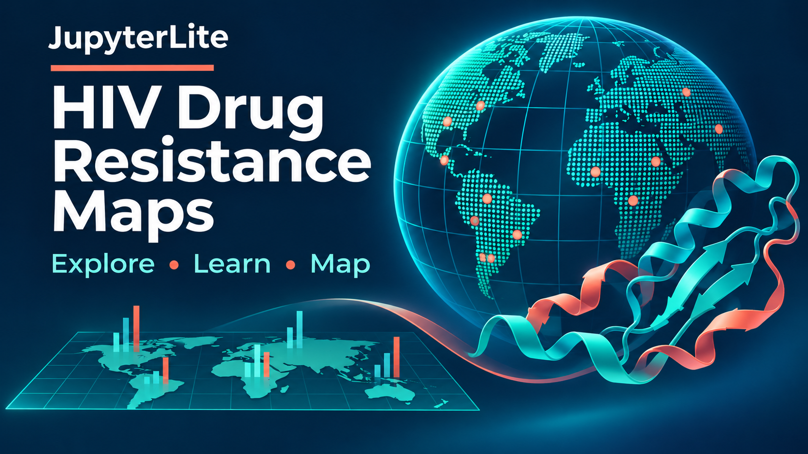

# HIV Drug Resistance Maps

**[Open JupyterLite Lab](https://jltobias.github.io/JupyterLite-HIVDB-Drug-Resistance-Maps/lab/index.html)** · **[Read the Jupyter Book](https://jltobias.github.io/JupyterLite-HIVDB-Drug-Resistance-Maps/book/)**

Learn the fundamentals of HIV drug resistance, explore historical surveillance evidence, and build reproducible maps in your browser. The illustration is conceptual: its markers and bars are not data.

## Follow the notebooks

Each numbered chapter is built directly from the matching notebook in `content/`. Use **Open this notebook in JupyterLite Lab** at the top of a chapter to edit and run the same material. The book executes the notebooks during its build, so tables and figures are available for reading; the Lab provides the interactive Python environment.

- **00 — Fundamentals:** biology, drug classes, mutation notation, and interpretation.
- **01 — Data coverage:** source provenance, study coverage, and denominators.
- **02 — Global TDR choropleth:** overall and drug-class 2D maps.
- **03 — Drug class and time:** historical patterns and sampling years.
- **04 — Pediatric MCH case study:** selected-population estimates and fictional genotype exercises.
- **05–08 — Conditional templates:** mutation geography, resistance strata, subtype standardization, and NNRTI-to-DTG history. These chapters explain the additional inputs needed; they do not invent results when those inputs are absent.

## Understand the evidence

The default epidemiologic dataset is the CC0 S1 Table from [Rhee et al. (2015)](https://doi.org/10.1371/journal.pmed.1001810), not a current HIVDB export. Country summaries describe the included studies and should not be assumed to represent national prevalence. Read the [data provenance](DATA_SOURCES.md), [methodology](METHODOLOGY.md), and [citations and attributions](README.md#citation-and-attribution) alongside the chapters.

Explore the [2D maps, 3D maps, globes, 3D scenes, and other resources](content/mapping_resources.md). This is an educational project; it does not provide individual treatment recommendations.
